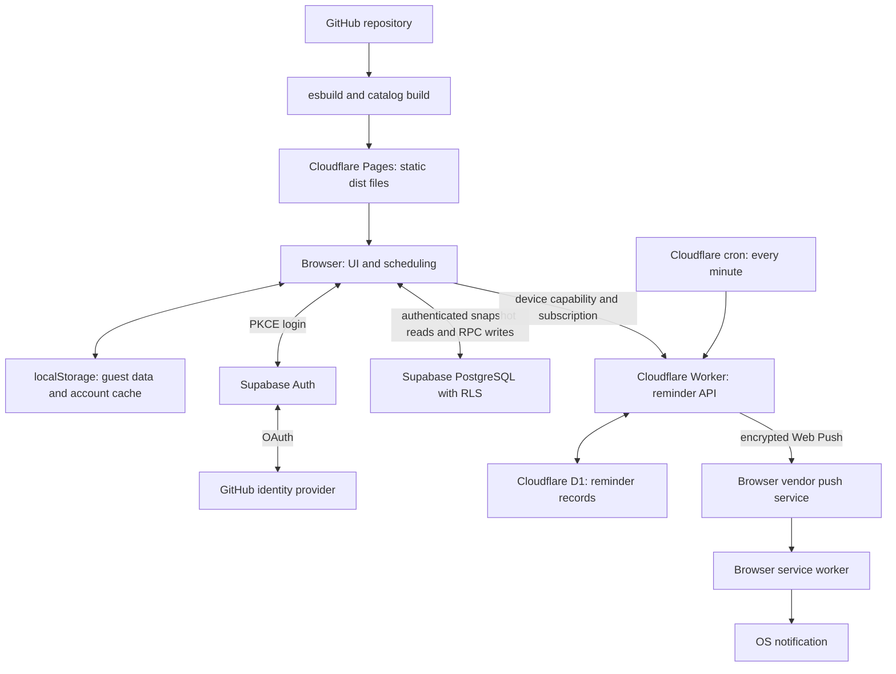
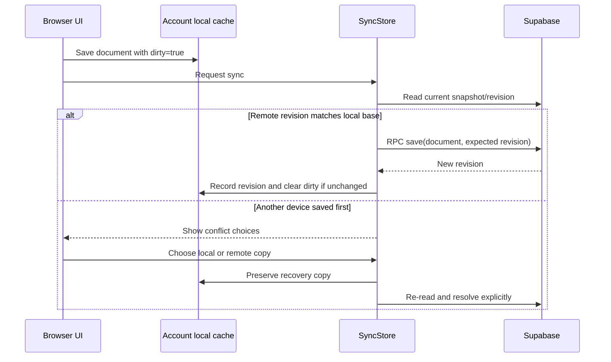

# RecallCode: codebase, system design, and operations

This guide explains the implementation on `main` after the progress, sound, and push-reminder release (October 20, 2026). Configuration instructions describe required setup; they are not proof that a particular user's login or notification delivery has succeeded.

## 1. What the application does

RecallCode teaches coding-interview reasoning through question-centered flashcards. A question has context, personal notes, an explanation, full Java code, and multiple cards. Students reveal an answer and rate their recall as Again, Hard, Good, or Easy. Each card gets its own next-review date.

The catalog contains 250 curated questions. Students enroll selected questions into their practice library; simply browsing a question does not enroll it. The UI includes daily review, catalog search/filtering, question management, a card editor, history, progress, and data/settings controls. The context panel exposes Problem, Notes, Solution, and Full code tabs.

The application does not execute submitted code, judge correctness, submit to LeetCode, or generate AI feedback. Sounds and question colors reflect the student's self-rating. Green is a recent recall signal, not proof of permanent mastery.

## 2. Architecture and service responsibilities



| Component | Role | Does not own |
| --- | --- | --- |
| Browser | Rendering, review scheduling, progress calculations, local persistence, sound, push opt-in | Server secrets or trusted authorization decisions |
| Cloudflare Pages | Serves HTML, CSS, bundled JavaScript, catalog, icons, manifest, and service worker | User study database or login sessions on a server |
| Supabase Auth | Login/session handling; GitHub OAuth is the default provider | Reminder subscription management |
| Supabase PostgreSQL | One account-owned study snapshot per user, access policies, revision-checked writes | The shared catalog or push delivery queue |
| Cloudflare Worker | Reminder API, subscription validation, scheduled encrypted pushes | Flashcards, review history, or Supabase authentication |
| Cloudflare D1 | Device subscriptions, chosen times/time zones, next-send times and retry metadata | Study progress or GitHub OAuth secrets |
| GitHub | Source history, code review, CI, manually triggered Pages deployment; also a separate OAuth identity provider | Production study or reminder data |

There is no always-running application server. Guest practice works without Supabase. Reminder enrollment works without login because it uses a separate device capability. These choices keep the initial system small, but reminders will continue after sign-out until disabled.

## 3. Repository map

Paths below are relative to the repository root.

| File or directory | Responsibility |
| --- | --- |
| `index.html` | Document shell, app/modal mount points, asset and manifest links |
| `src/app.js` | View state, HTML rendering, event handling, CRUD, rating actions, backup/import, integration with cloud and device preferences |
| `src/styles.css` | Responsive layout, context panel, forms, status colors and presentation |
| `src/model.js` | Document validation, new-card defaults, deterministic scheduler, due queue, question deletion |
| `src/seed.js` | Small starter practice dataset for a new guest |
| `src/catalog/arrays.js` | Authored array/search/window and related curriculum content |
| `src/catalog/structures.js` | Authored data-structure curriculum content |
| `src/catalog/graph-dp.js` | Authored graph, dynamic-programming and related content |
| `src/catalog-data.js` | Generated public curriculum; do not edit directly |
| `src/catalog.js` | Enrollment, catalog lookup, compact snapshot packing and expansion |
| `src/cloud.js` | Supabase client, PKCE OAuth/session events, remote read/write adapter |
| `src/sync-store.js` | Account cache, dirty state, serialized sync, revision conflicts and recovery |
| `src/progress.js` | Latest ratings, per-question colors, distinct-card and attempt counts |
| `src/profile.js` | Account identity, membership date, practice totals and profile navigation; renders provider metadata as escaped text |
| `src/feedback.js` | Local sound preferences and synthesized Web Audio feedback |
| `src/reminders.js` | Browser permission, service-worker registration, push subscription, reminder API client |
| `sw.js` | Receives push events, displays notifications, opens/focuses the app on click |
| `manifest.webmanifest`, `icon-*.png`, `favicon.svg` | Installable app metadata and icons |
| `worker/index.js` | Reminder HTTP routes, encrypted push sending, cron processing |
| `worker/shared.js` | Time-zone calculation, endpoint/key validation, SHA-256 hashing |
| `worker/schema.sql` | D1 reminder table and due-time index |
| `worker/wrangler.toml` | Worker name, origin, public VAPID key, D1 binding, cron |
| `supabase/migrations/202610200001_study_sync.sql` | PostgreSQL table, RLS policies and save RPC |
| `scripts/build.mjs` | Public configuration validation, catalog generation, esbuild bundle, static output and security headers |
| `scripts/catalog.mjs` | Combines authored catalog modules; strips Java test programs from public output |
| `scripts/serve.mjs` | Local static server |
| `scripts/deploy.mjs` | Cloud-configured build followed by Pages production deployment |
| `scripts/setup-push-keys.mjs` | One-time VAPID generation/secret installation; refuses replacement of configured keys |
| `scripts/verify-java.mjs`, `scripts/format-java.mjs` | Java verification and source formatting utilities |
| `tests/*.test.mjs` | Model, catalog, sync, database, progress and reminder tests |
| `tests/browser/` | Playwright user-flow tests |
| `.github/workflows/ci.yml` | Push/PR checks |
| `.github/workflows/deploy.yml` | Manually dispatched Pages deployment |
| `docs/` | Deployment, research, Java verification evidence and this guide |

The frontend uses JavaScript ES modules and direct DOM rendering, not React or a client-side routing framework. `app.js` coordinates the feature modules; business rules that can be tested independently live outside it.

## 4. Study data model

The expanded document has `version: 1`, `questions`, `cards`, `history`, and optional `settings` with `newCardsPerDay`.

| Entity | Important fields | Meaning |
| --- | --- | --- |
| Question | `id`, `title`, `difficulty`, `url`, `tags`, `context`, `notes`, `solution`, `code`, `language` | One interview problem and its learning material |
| Catalog metadata | `catalogId`, `catalogVersion` | Links enrolled content to the shared curriculum |
| Card | `id`, `questionId`, `front`, `back`, `type` | One recall prompt belonging to a question |
| Card schedule | `due`, `interval`, `ease`, `reviews`, `lapses`, `suspended` | Due timestamp, interval in days, ease factor and practice state |
| Review event | `cardId`, `rating`, `at` | One self-rating at an epoch-millisecond timestamp |

Deleting a question also removes its cards and their review history. Validation rejects duplicate IDs, missing parent references, unsupported ratings, malformed fields and oversized collections. The limits are 10,000 questions, 100,000 cards and 200,000 history events; practical browser/cloud capacity may be reached earlier.

### Storage locations

| Location | Key/table | Contents |
| --- | --- | --- |
| Browser localStorage | `recallcode.v1` | Guest study document |
| Browser localStorage | `recallcode.account.<user-id>` | Account envelope: revision, dirty flag and expanded data |
| Browser localStorage | `recallcode.account.<user-id>.recovery` | Local copy saved before resolving a sync conflict |
| Browser localStorage | `recallcode.feedback.v1` | Device sound preference and volume |
| Browser localStorage | `recallcode.reminders.v1` | Device capability, reminder time/zone and setup state |
| Supabase | `public.study_snapshots` | Compact account document and revision |
| D1 | `reminders` | Device push subscription and scheduling metadata |

The Supabase SDK also persists its session in browser storage. Local storage is origin-specific: localhost, preview domains and the production domain do not share it. A shared browser profile can retain account caches after sign-out; do not treat it as encrypted private storage.

### Compact catalog references

`packData()` replaces unchanged question content with a `$catalog` reference and keeps personal overrides. It removes unchanged card text/type while retaining schedules. `unpackData()` rebuilds full content from the bundled catalog. This avoids uploading 250 full solutions for every account.

The catalog version must match when unpacking. Changing the curriculum version requires compatibility planning; there is no automatic historical-catalog migration. Preserve stable question IDs and card ordering because card references include their array index. A normal JSON backup contains expanded content and is more portable than a compact database snapshot.

## 5. Review scheduling, progress, and sounds

New cards start with interval 0, ease 2.5, zero reviews/lapses and an immediate due date. The scheduler is SM-2-inspired, not Anki/FSRS-compatible.

| Rating | Next interval | Ease effect |
| --- | --- | --- |
| Again | Reset interval to 0; retry after 60 seconds | Minus 0.2, minimum 1.3; increment lapse count |
| Hard | 1 day initially; otherwise rounded interval × 1.2, minimum 1 | Minus 0.15, minimum 1.3 |
| Good | 1 day initially; otherwise max(previous + 1, rounded interval × ease) | Unchanged |
| Easy | 4 days initially; otherwise max(previous + 1, rounded interval × ease × 1.3) | Plus 0.15, maximum 3.5 |

Every rating increments reviews and appends history. Due reviews are prioritized ahead of new cards. The new-card budget defaults to 10/day and counts cards first reviewed since the browser's local midnight. Suspended cards are excluded. Question siblings are interleaved where possible; their schedules remain independent.

Progress counts reviewed cards once, using `reviews > 0`. Total attempts count history events, so repeated practice increases attempts without increasing distinct completed cards. Today's count uses the browser's local calendar day.

Question colors use the latest ratings of active cards, in this precedence order:

1. No active cards: paused.
2. Any latest Again: red / needs another try.
3. Every active card latest Good or Easy: green / strong recall.
4. Some reviewed cards: amber / in progress.
5. Otherwise: gray / not reviewed.

Overall card counts include paused cards; question colors exclude them. Labels accompany colors. Sounds are synthesized with Web Audio: a bright Good/Easy sequence, gentle Hard cue, and soft Again cue. Sound starts disabled, supports volume/mute and preview, and does not change review persistence if playback fails.

## 6. Supabase: authentication, authorization, and sync

`cloud.js` creates a Supabase client only when both public URL and public key are present. Authentication uses PKCE, persisted sessions, token refresh and callback detection. GitHub is the default provider; optional email/password mode exists but requires appropriate email setup for public use.

OAuth has two distinct redirects: GitHub returns to the Supabase `/auth/v1/callback` URL, then Supabase returns the user to the allowed app URL. The OAuth client secret belongs in the Supabase provider settings, never in the frontend.

`study_snapshots` has a primary-key `user_id` referencing `auth.users` with cascading deletion, a JSONB object `document`, a positive `revision`, and `updated_at`. A database constraint limits the document's text representation to 5 MiB.

Row-level security limits authenticated reads/inserts/updates to `auth.uid() = user_id`. Anonymous access is not granted. The `save_study_snapshot(document, expected_revision)` RPC runs as the invoking user, derives identity from the session and increments the revision only when the expected revision matches. A competing save raises SQLSTATE `40001`.



`SyncStore` serializes local uploads, catches edits made while a save is running, and uses an epoch counter to ignore old account requests after account switching. Failed network requests leave the local data dirty for retry. Sync is triggered on changes, reconnect/online events, and app visibility; there is no realtime subscription or automatic field-level merge.

Guest and account datasets are separate. Guest import into an account is an explicit replacement operation. Local-versus-cloud conflict resolution chooses a whole document. RLS enforces ownership, while the app's RPC supplies its normal concurrency protocol; authenticated direct table writes are also granted by the migration and do not inherently enforce that RPC revision protocol. Do not describe revision checks as a protection against a malicious account owner.

## 7. Cloudflare reminders: API and delivery

The browser requests notification permission after the user enables reminders, registers `sw.js`, obtains the public VAPID key, and creates a push subscription. A random 32-byte device capability is stored locally and sent as a bearer token; D1 stores its SHA-256 hash as the record ID. This is device authorization, not Supabase identity.

All routes pass through an exact `Origin == APP_ORIGIN` check, including health/config requests. CORS alone is not authentication: non-browser clients can supply Origin headers. Device capabilities protect mutation of existing records; registration remains open subject to basic limits.

| Route | Purpose | Device token |
| --- | --- | --- |
| `GET /health` | Service health response | No |
| `GET /config` | Public VAPID key | No |
| `PUT /subscription` | Create/update subscription, local time and zone | Required |
| `DELETE /subscription` | Delete the caller's reminder record | Required |
| `POST /test` | Send a test push; 60-second cooldown | Required |

D1 fields are `id`, unique `endpoint_hash`, `subscription` JSON text, `time` (`HH:mm`), `zone`, `next_at`, `updated_at`, `test_at`, and `failures`. `next_at` has an index. Push subscription data is sensitive delivery material and should not appear in public logs or screenshots.

The cron runs every minute and selects up to 10 due rows. It claims each row using a conditional update before sending, calculates the next local-calendar reminder with Luxon, encrypts the payload and signs Web Push requests with VAPID. The browser vendor's push service delivers to the service worker, which displays a notification even without an open app tab when the platform permits it. Clicking focuses an existing app window or opens one.

Expired endpoints (404/410) are deleted. The first two failures retry after five minutes; later failures move to the next daily time; eight consecutive failures remove the record. Payload TTL is one hour and the outbound request timeout is ten seconds. Claims reduce duplicate processing but are not exactly-once delivery: a crash after claiming can miss that reminder, and uncertain network outcomes can cause retries.

Subscription endpoints must be HTTPS and match supported browser push-provider hosts; redirects are rejected to reduce SSRF risk. Current code limits total records to 1,000 and checks recent updated records before allowing new registrations (threshold 100 in an hour). These are basic application guards, not atomic quotas or a comprehensive abuse-control system. If 1,000 users choose the same minute, a ten-per-minute batch can take about 100 minutes to drain before other limits or failures, so delivery is approximate.

Disabling first unsubscribes in the browser, then deletes the server record. If deletion fails, the UI exposes a retry. Clearing storage can lose the device capability without immediately deleting the server row; disable reminders before clearing data. The UI's saved enabled flag is not continuous proof of remote delivery. `sw.js` has no fetch/cache handler: an installable PWA is not currently a fully offline-loadable app.

## 8. Configuration and secret boundaries

| Setting | Location | Classification |
| --- | --- | --- |
| `SUPABASE_URL` | Local `.env` / GitHub Actions variable | Public, embedded at build time |
| `SUPABASE_PUBLISHABLE_KEY` | Local `.env` / Actions variable | Public publishable or legacy anon key; RLS must remain enabled |
| `AUTH_MODE` | Build environment; default `github` | Public; the workflow does not currently expose a dedicated variable |
| `REMINDERS_URL` | Local `.env` / Actions variable | Public Worker origin, embedded in bundle/CSP |
| `CLOUDFLARE_ACCOUNT_ID` | Deployment environment / Actions variable | Deployment identifier |
| `CLOUDFLARE_API_TOKEN` | Actions secret or authorized CLI login | Secret; never ship in static files |
| `APP_ORIGIN`, `VAPID_PUBLIC_KEY` | `worker/wrangler.toml` | Public Worker configuration |
| `VAPID_PRIVATE_KEY` | Cloudflare Worker secret | Secret; never commit or print |
| `DB` | Worker D1 binding | Binding to reminder database |
| GitHub OAuth client secret | Supabase GitHub provider settings | Secret; not a build variable |

The build rejects recognizable Supabase secret/service-role keys, invalid configured origins, and incomplete URL/key pairs. Public environment changes require rebuilding Pages; changing a provider dashboard value alone does not rewrite an existing bundle. Generated security headers restrict scripts, framing and network connections. Frontend credential checks complement, but do not replace, careful secret handling.

## 9. Local development and verification

Use Node.js 22+ (a current supported patch version), npm and JDK 17+. Run commands from the repository root.

```sh
npm ci
# Optional: copy .env.example to .env and supply public project configuration.
npm start
```

Open `http://127.0.0.1:4173`. `npm start` builds and serves `dist`; `npm run dev` is an alias, not a hot-reloading dev server. Without cloud variables the app runs in guest mode. Do not accidentally use an older Node executable from PATH: reminder tests use `node:sqlite`.

```sh
npm test
npm run test:java
npm run build
npx playwright install chromium
npm run test:e2e
```

Unit tests cover model invariants, enrollment/packing, sync races/account separation, progress and reminder behavior. PGlite tests run PostgreSQL policy/RPC behavior locally. Reminder tests use a SQLite adapter and mocked push transport; they do not prove delivery on a real device. Playwright covers browser flows. Java programs exercise catalog examples and edge cases; they do not establish acceptance against LeetCode hidden tests.

Playwright starts its own server and does not reuse an occupied port. Set `PORT` to an available port if needed. `PLAYWRIGHT_CHANNEL=msedge` can select installed Edge. Local reminder API calls will fail against the production Worker origin restriction: use a separate development Worker/database and matching `APP_ORIGIN`, rather than loosening production restrictions.

## 10. Deployment runbook

There are three independently deployed components: Supabase schema/auth configuration, Cloudflare reminder Worker/D1, and Cloudflare Pages static assets. A frontend deployment does not migrate either database or deploy the Worker.

### A. Supabase setup

1. Create the project and apply `supabase/migrations/202610200001_study_sync.sql` once through a trusted database workflow. It is not a general repeatable migration runner: its policy creation statements are not all idempotent.
2. Configure the GitHub OAuth app callback as `https://<project-ref>.supabase.co/auth/v1/callback`.
3. Enable the GitHub provider in Supabase with the OAuth client ID and secret.
4. Set the Supabase Site URL and allowed app redirect to `https://recall-code.pages.dev/`; add only required development redirects.
5. Supply the public URL/key to the frontend build. Verify a real login and a second-device sync before reporting production auth complete.

### B. Reminder Worker and D1

The existing project already has a configured D1 binding and VAPID public key. Do not recreate the database or regenerate keys during routine releases.

For a new independent environment, authenticate Wrangler, create a D1 database, place its returned ID in an environment-specific configuration, and set the matching app origin. Then apply the schema:

```sh
npx wrangler d1 execute recall-code-reminders --remote --config worker/wrangler.toml --file worker/schema.sql
```

Only for first-time setup with no configured VAPID keys, run the reviewed `node scripts/setup-push-keys.mjs` helper. It installs the private key as a Worker secret and persists the public key in configuration. Existing subscriptions depend on that key pair; rotation requires a deliberate re-enrollment plan.

```sh
npx wrangler deploy --config worker/wrangler.toml
```

Use the returned HTTPS Worker origin as `REMINDERS_URL`. The build currently accepts `workers.dev` origins, so a custom Worker domain requires a validation change. Verify configuration and D1 binding without exposing tokens/subscriptions:

```sh
curl -H "Origin: https://recall-code.pages.dev" https://recall-code-reminders.vishal567795vis.workers.dev/health
npx wrangler tail --config worker/wrangler.toml
```

Do not add sensitive request bodies or authorization headers to logs. Cron configuration is deployed with the Worker; it does not depend on a browser timer or this assistant staying open.

### C. Cloudflare Pages

The Pages Direct Upload project is `recall-code`. Build output is `dist/`; never upload `.env`, credentials, dependency directories or database exports.

```sh
npm run deploy
```

This invokes the build with `REQUIRE_CLOUD=1` and uploads `dist` with `--branch main`. It targets production even if the local Git branch is a feature branch. Use a separate explicit preview deployment if that is the intention. `REQUIRE_CLOUD` checks presence of public configuration, not whether OAuth actually works.

For GitHub deployment, set repository variables `CLOUDFLARE_ACCOUNT_ID`, `SUPABASE_URL`, `SUPABASE_PUBLISHABLE_KEY`, and `REMINDERS_URL`; set the scoped deployment token as secret `CLOUDFLARE_API_TOKEN`. Run the **Deploy Cloudflare Pages** workflow manually from the intended revision. It installs dependencies, runs unit tests and deploys. It does not run the Java/browser suites or deploy the Worker, so use the full CI result as the release gate.

Pushes and pull requests run **Check RecallCode** automatically. Merging a PR does not automatically run the manually dispatched deployment workflow. The production URL is [recall-code.pages.dev](https://recall-code.pages.dev/).

### D. Release verification and rollback

Verify catalog browsing, one review/reload, progress counts/colors, sound/mute, GitHub login and second-device sync, account separation, and conflict handling. For reminders, allow permission on the target device, save a time/zone, send a test, and confirm visible delivery. API success only proves the push provider accepted the request. Confirm browser-closed behavior separately on each supported platform.

For a bad frontend release, redeploy a known-good revision or use an available Pages rollback. For a Worker regression, redeploy the known-good Worker with its compatible binding/configuration. Keep VAPID keys stable. Neither action reverses database changes or user-data edits; use backups and separately reviewed recovery steps. Export user JSON before replacing data and preserve schema compatibility across releases.

## 11. Troubleshooting

| Symptom | Check |
| --- | --- |
| Login button missing/disabled | Was the build given both public Supabase values? |
| OAuth fails or returns to the wrong site | GitHub callback versus Supabase app redirect, provider enabled, actual client ID/secret, exact origin |
| Local edits exist but sync fails | Network/session, applied SQL, RLS/RPC access, 5 MiB snapshot ceiling, displayed sync status |
| Conflict shown | Export first; choose local/cloud deliberately; the recovery key preserves the preceding local envelope |
| Catalog version error | Reload the deployed bundle; investigate migration compatibility rather than overwriting user data |
| No sound | Enable sounds, inspect volume/mute and browser audio restrictions; use preview controls |
| Reminder permission blocked | Change the site's browser Notifications setting to Allow; text approval in a chat does not change it |
| Reminder API returns 403 | Request Origin must exactly match the Worker `APP_ORIGIN` |
| Reminder enabled but no visible notification | Device/DND/background restrictions, connectivity, subscription expiry, Worker cron/logs and queue backlog |
| Push key/subscription mismatch | Preserve the deployed VAPID pair; intentionally re-enroll affected devices if keys changed |
| Test push returns 429 | Wait at least a minute before another test |
| Old assets or settings appear on preview | Verify the URL and deployed revision; origin-local settings differ between preview and production |

## 12. Tradeoffs and next design steps

The static catalog reduces database writes and lets content ship with the application. A whole-document snapshot makes export and initial synchronization simple, but writes grow with history and concurrent devices must resolve whole-document conflicts. A future per-question/card/event schema could support incremental updates and finer conflict resolution at greater migration/query complexity.

The reminder service is intentionally separate from study data. It sends a generic daily message, cannot tell whether a user already studied that day, and has no shared cross-device reminder preference. Account-linked reminders, smarter timing and suppression would need an explicit identity/data integration.

Before broader adoption, improve registration abuse controls, atomic capacity enforcement, queue throughput, delivery observability, backups, schema/catalog migrations and device testing. Current claims are bounded: no automatic grading, guaranteed notification delivery, realtime collaboration, fully offline shell, or exactly-once push semantics.

The architecture is intended for small-scale operation on free plans, not a promise of unlimited free hosting. Review actual provider quotas and usage before launch or growth; this guide does not freeze prices or allowances. Cloudflare serves public assets and executes reminder work; Supabase consumes auth/database resources for account use. A custom domain, expanded quotas or email infrastructure can add cost.

## 13. Related documentation

- [Project README](../README.md)
- [Deployment setup](deployment.md)
- [Curriculum research methodology](research.md)
- [Supabase migration](../supabase/migrations/202610200001_study_sync.sql)
- [Worker configuration](../worker/wrangler.toml)
- [CI workflow](../.github/workflows/ci.yml)
- [Pages workflow](../.github/workflows/deploy.yml)

For current provider behavior and limits, consult [Supabase documentation](https://supabase.com/docs), [Cloudflare Pages documentation](https://developers.cloudflare.com/pages/), [Workers documentation](https://developers.cloudflare.com/workers/) and [D1 documentation](https://developers.cloudflare.com/d1/). Repository code and deployed configuration remain the authority for RecallCode's own behavior.

## 14. Leaderboard

The Leaderboard screen (`src/leaderboard.js`, coordinated by `src/app.js`) requires login to view community rankings. Participation is separately opt-in: a user chooses a 2–30 character nickname, joins, can rename it, and can leave. No email is copied into the nickname by default. Nicknames are not verified identities or unique handles, and are HTML-escaped when rendered.

Apply `supabase/migrations/202610200002_leaderboard.sql` after the study-sync migration, then deploy Pages. No Worker/D1 change is needed. This migration creates `leaderboard_profiles`, owner-only profile reads, a score trigger on study snapshot inserts/updates, and two authenticated RPCs. It is a one-time migration; for manual application, wrap it in a transaction to avoid partially applied DDL.

`set_leaderboard_profile(display_name, participating)` derives the account ID from the authenticated session and computes its score from its existing snapshot. It does not accept a client-supplied score or target user ID. `get_leaderboard()` returns the top 100 learners plus the caller's own entry if participating, with shared ranks for equal scores. The returned fields are only rank, display name, correct-card count and `is_me`. Profile table access does not expose other users' IDs or preferences. These narrow functions use a fixed search path and explicitly granted execution permissions; anonymous callers cannot invoke them.

The score is the number of distinct existing card IDs whose latest history entry (timestamp, then history order to break ties) is Good or Easy. Orphan history is ignored. Again/Hard lowers the score; repeat Good/Easy reviews do not multiply it. Custom and suspended cards count. Snapshot updates refresh the score in the same database transaction, including imports/restores. Rankings reflect synced data, while the local summary can include pending edits. Viewers refresh on opening the screen or pressing Refresh rankings; the current user's successful sync also reloads an open leaderboard.

This is a motivational, self-reported scoreboard. Because snapshots, custom cards and self-ratings originate in the browser, it is not cheat-proof or suitable for prizes, certification or verified skill ranking. Server derivation prevents a direct score-column update but cannot prove that a learner actually recalled an answer. There is no weekly reset or immutable achievement history. Leaving hides the entry from subsequent leaderboard reads; it does not erase copies someone already saw. Private study data stays in the existing RLS-protected snapshot table.

Tests cover duplicate reviews/cards, latest-rating order, orphan history, opt-in/out, equal ranks, unauthorized score changes, anonymous and cross-account access, safe nickname rendering, guest gating and mobile layout. Live account testing still depends on the GitHub OAuth provider being correctly configured.
